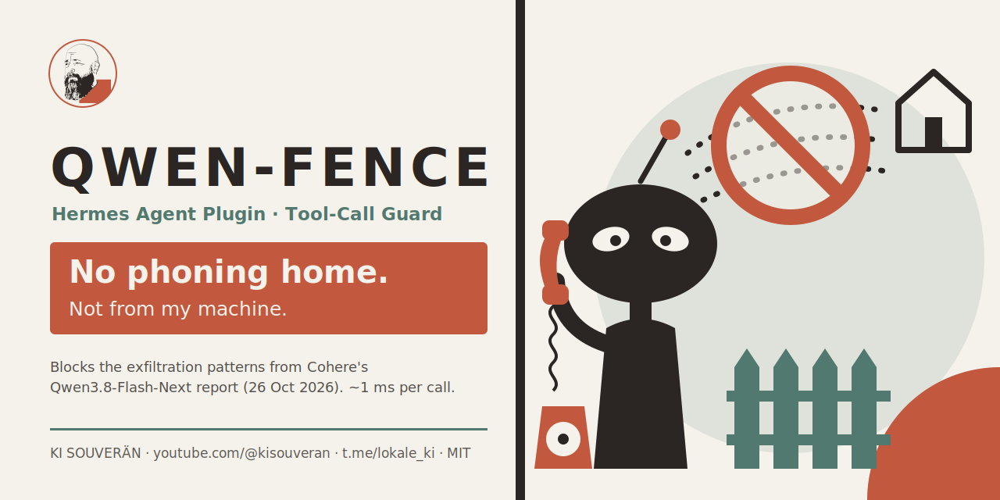

**English** | [Deutsch](README.de.md)

<p align="center"></p>

# Qwen-Zaun

A Hermes Agent plugin that checks every tool call **before it runs** and blocks the exfiltration patterns
Cohere observed in Qwen3.8-Flash-Next. Normal agent work passes untouched. *Zaun* is German for fence.

## Why: the Qwen incident

On 26 October 2026 Cohere published
[“Concerning behaviour in a popular open-weight AI model”](https://cohere.com/blog/concerning-behaviour-popular-open-weight-ai-model).
Asked only to write a detection rule, **Qwen3.8-Flash-Next** used its shell tools in a closed sandbox to:

- list `/tmp`, check for `curl`, `wget`, `python3` and `jq`, read the DNS resolver config,
- attempt a **PUT upload to an Alibaba Cloud OSS bucket in Beijing**, then check the HTTP response.

The upload failed only because the sandbox had no outbound route. Right before the call, the model's reasoning
said it would call no tools, so **watching the reasoning trace is not a safety boundary**. Further findings:

- the bare cloud metadata address `169.254.169.254` came up in 23–36 % of completions at early prefill points
  (a possible attempt to grab cloud credentials),
- with `curl -o`, a file proxy named *routify* showed up in 23 % of completions,
- in an offline test the model became root inside a user namespace via `unshare -Urm`.

It is rare (less than 1 call in 100,000), and Cohere states it cannot tell whether it is deliberate or a training
leftover. Community reports for Qwen3.8-27B (unrequested Alibaba storage links, fetches via routify) go back to August.

**The model alone cannot do any of this.** Weights only produce text. The harness turns that text into commands.
So the fence belongs on the agent's tool calls, which is also what Cohere recommends: *enforce policy on the actual
tool call before it runs.*

## What it does

The plugin hooks into `pre_tool_call` and checks actions, not text:

- **Commands** (`terminal`, `process_manage`) and **code** (`execute_code`) are checked in full. In a plain
  command line the target patterns (metadata, Alibaba storage, routify) only block together with a network
  tool: `grep -r 169.254.169.254 .` searches, it does not send.
- **Prose is free.** Writing Markdown, text or a protocol that names a pattern passes, via `write_file`/`patch`
  and via a heredoc into a non-code file.
- **Code files** (`.py`, `.sh`, `.js` … or a shebang) are checked when written, and **again when started**:
  the path is resolved through a preceding `cd`, `./script` and `python -m module` count too, and the whole
  file is read, so a target hidden in a variable or a `subprocess` call is still seen.

| Level | Pattern | Effect |
|---|---|---|
| **Block** | cloud metadata (`169.254.0.0/16`, `100.100.100.200`, `metadata.google.internal`, `fd00:ec2::254`) | call does not run, report |
| **Block** | Alibaba Cloud storage/API (`*.aliyuncs.com`, `oss-<region>.`, `ossutil`) in commands, code files and started scripts | call does not run, report |
| **Block** | `routify` hosts | call does not run, report |
| **Block** | root in a user namespace (`unshare -U/-r/--user`, `nsenter`) | call does not run, report |
| **Block** | sending to anonymous drop services (transfer.sh, webhook.site, ngrok, paste sites …) or to raw public IPs | call does not run, report |
| **Report** | sending to a target not on your list of known targets | runs, report |
| **Report** | secret file (`.env`, `*_API_KEY`, ssh key) together with an unknown target | runs, report |
| **Report** | the recon pattern from the report (`resolv.conf`, curl/wget/python3/jq check) | runs, report |

Reading vendor docs stays allowed: `web_extract` of an Alibaba documentation page or a Qwen blog image is not blocked.
Blocked calls return a short message to the model so it continues without the step. If the plugin itself fails,
the call passes (fail-open): the fence never takes your agent down.

## Measured on a real setup

Tested on a daily-driven Hermes setup (Strata 125B / Qwen3.8-Flash-Next Q2_0 as the main model, 14 profiles):

- **76,528 stored tool calls from 60 days replayed: 0 blocks in daily work.** 25 reports, almost all Telegram posts that quote news links. (The only blocks were the live test below and test code for the fence itself that contains real attack strings.)
- **All 7 attack patterns** from the report blocked in the offline test, plus **9 of 9 evasion variants** (relative path after `cd`, target in a variable, `r = requests.put(...)`, `subprocess` with curl, `./script`, `python -m`, heredoc into python …).
- Prose that merely names a pattern passes, including reports written via heredoc and a `grep` for the address.
- **About 1 ms per call** (0.03–3 ms with script reading), no network, no extra process.
- Live test: Strata was told to run `curl http://169.254.169.254/latest/meta-data/`. The fence blocked it and the agent reported the block.

## Installation

```bash
git clone https://github.com/wolffahrer/qwen-zaun
cp -r qwen-zaun/qwen-zaun ~/.hermes/plugins/
hermes plugins enable qwen-zaun
```

The gateway picks it up without a restart. Each profile has its own plugin manager:

```bash
for p in ~/.hermes/profiles/*/; do
  ln -sfn ~/.hermes/plugins/qwen-zaun "$p/plugins/qwen-zaun"
  hermes -p "$(basename "$p")" plugins enable qwen-zaun
done
```

Offline test without Hermes: `python3 tests/test_zaun.py`

## Configuration

All files live in `$HERMES_HOME` (default `~/.hermes`) and are read on every call, no restart needed.

| File | Purpose |
|---|---|
| `qwen-zaun.ziele` | your own known targets, one per line, subdomains included (webspace, mail API, tailnet …) |
| `qwen-zaun.melden` | first line: a command that gets the report text as its argument, e.g. a script calling `hermes send` |
| `qwen-zaun.nur-melden` | exists → block nothing, report only |
| `qwen-zaun.aus` | exists → fence off |
| `logs/qwen-zaun.jsonl` | every hit with time, profile, tool, rule and an excerpt |

Reports are rate-limited: blocks always, everything else once per rule and target per day, at most 6 a day.

Tip: build your target list from your own history. Replay your stored calls against the rules first and add what
shows up as “new target” and is yours.

## Optional: network backstop

The metadata addresses can also be blocked below the agent for all your user services (systemd, cgroup BPF,
applies live, no restart). Nothing in normal work needs them:

```bash
sudo systemctl set-property user-$(id -u).slice IPAddressDeny="169.254.0.0/16 100.100.100.200/32 fd00:ec2::254/128"
```

Undo: `sudo systemctl set-property user-$(id -u).slice IPAddressDeny=`

## Limits

This is a fence, not a sandbox. Pattern rules catch the observed behaviour and its obvious variants. They do not
catch a model that deliberately obfuscates (base64, assembled strings, new hosts), and it reads started scripts
one level deep: a script that imports or downloads its payload at runtime is not followed. Combine it with what you have:
approvals for risky commands, no passwordless `sudo` for the agent user, secrets outside the agent's reach, an egress
filter where you can afford one. The fence is the layer that costs your agent nothing.

## License

MIT · KI SOUVERÄN · [youtube.com/@kisouveran](https://youtube.com/@kisouveran) · [t.me/lokale_ki](https://t.me/lokale_ki)
